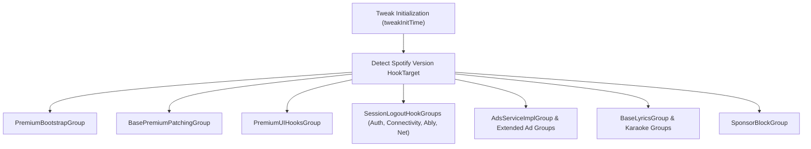
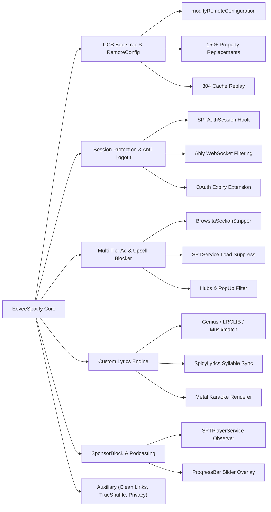

# EeveeSpotifyReincarnated Codebase Analysis: Architecture & Overview

## 1. Executive Summary & Project Lineage

[EeveeSpotify](https://github.com/whoeevee/EeveeSpotify) was originally developed by whoeevee as an iOS tweak targeting the Spotify iOS client. Following original development and forks by Meeep1, the active maintenance and modern iOS 17/18/26+ and Spotify v9.1.x compatibility efforts transitioned to [EeveeSpotifyReincarnated](https://github.com/SideloadLabs/EeveeSpotifyReincarnated) under [SideloadLabs](https://github.com/SideloadLabs) (led by jaydenjcpy, faroukbmiled, Mod4, and contributors).

Unlike Android Xposed modules (such as SpotXero, which hook ART at runtime using LibXposed and DexKit dynamic bytecode scanning), EeveeSpotify is designed for iOS environments:
- **Rootless jailbreak / tweak injection**: Injected via MobileSubstrate / ElleKit / Substitute into the `com.spotify.client` Mach-O process.
- **Sideloaded / Sandboxed IPAs**: Packed directly into decrypted Spotify IPAs using tools like Sideloadly, AltStore, LiveContainer, or TrollStore with `CydiaSubstrate.framework` or Orion dylibs bundled into `Frameworks/`.

## 2. Core Tech Stack & Framework Dependencies

| Layer | Technology | Role & Purpose |
| :--- | :--- | :--- |
| **Hooking Engine** | [Orion](https://github.com/theos/orion) | Type-safe Swift hooking framework built on top of libsubstitute/CydiaSubstrate. Provides `ClassHook<T>`, `HookGroup`, and property wrappers. |
| **Runtime Language** | Swift 5.8 / 5.9 + Objective-C | Core tweak logic authored in Swift (`.x.swift` preprocessed by Orion) with Obj-C bridge headers and helper shims. |
| **Serialization** | SwiftProtobuf + XMLCoder | Native decoding and re-serialization of Google Protocol Buffers wire formats and XML payloads. |
| **UI Framework** | SwiftUI + UIKit | Native in-app settings panels, karaoke overlay views, liquid glass shaders, and popup dialogs. |
| **Graphics / Shader** | Metal (`.metal`) | Custom hardware-accelerated animated shaders for karaoke lyrics backgrounds (`KaraokeBackgroundShader.metal`). |

## 3. Orion Hook Engine & Version Adaptation Strategy

EeveeSpotify uses Orion's `HookGroup` construct to organize hooks into isolated, selectively activated clusters. This modularity ensures that if Spotify introduces breaking changes or renames classes in one subsystem, the remaining hook groups continue operating without crashing the app.

### Hook Groups Architecture



### Version Targeting (`VersionHookTarget`)

In `Sources/EeveeSpotify/Shared/Models/VersionHookTarget.swift`, Eevee classifies the running host application into:
1. `.v91`: Modern Spotify releases (v9.1.x and later). Uses updated Swift service names, scrollsita feed schemas, and new connectivity session modules.
2. `.lastAvailableiOS15`: Pinned releases for iOS 15 devices.
3. `.lastAvailableiOS14`: Pinned releases for iOS 14 legacy devices.
4. `.latest`: Generic baseline fallback for all modern 8.x / 9.x versions.

### Fault Tolerance & Error Handling

Orion normally throws a fatal error if a targeted class or method selector does not exist in the host binary. Eevee overrides `handleError` in `Tweak.x.swift`:

```swift
func handleError(_ error: OrionHookError) {
    switch error {
    case .targetNotFound(let cls):
        writeDebugLog("[INIT] non-fatal hook target missing: \(cls)")
        return
    case .targetHasIncompatibleType(let cls, let expected, let actual):
        writeDebugLog("[INIT] non-fatal type mismatch for \(cls): expected \(expected), actual \(actual)")
        return
    default:
        break
    }
    writeDebugLog("[INIT] fatal hook error: \(error)")
    exit(1)
}
```

This ensures resilient execution across varying Spotify IPA builds and sideloading configurations.

## 4. Subsystem Breakdown



