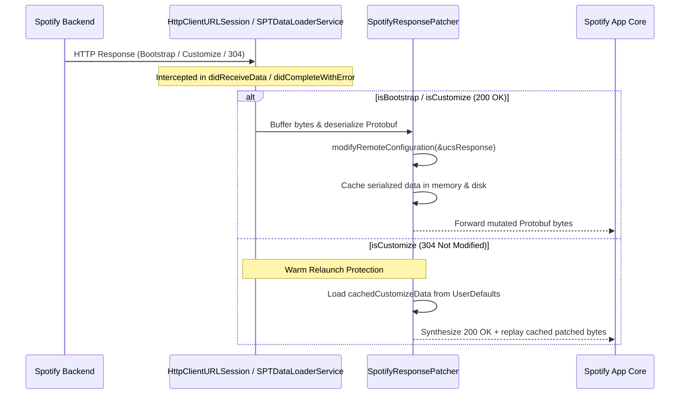

# UCS Bootstrap & RemoteConfig Mutation in EeveeSpotify

## 1. Spotify's Unified Configuration Service (UCS)

Spotify on iOS configures client capabilities, feature flags, UI experiments, and entitlement states through the **Unified Configuration Service (UCS)**. During application launch and background refresh cycles, Spotify initiates two primary network endpoints:
1. `/bootstrap/v1/bootstrap`: Delivers initial client initialization payload (`BootstrapMessage`), containing account attributes and configuration property assignments.
2. `/remote-config-orchestrator/v1/customize`: Delivers dynamic RemoteConfig assignments (`CustomizeMessage`) tailored to the user cohort and region.

Both payloads are serialized as Google Protocol Buffers.

## 2. Network Interception Architecture

Eevee hooks the network layer across two distinct URLSession delegate pipelines in Spotify:
1. `SPTDataLoaderServiceHook` / `SPTCoreURLSessionDataDelegate`: Legacy and core Objective-C networking stack.
2. `HttpClientURLSessionHook` (`Connectivity_HttpClientKit.HttpClientURLSession`): Modern Swift networking stack used on iOS for `bootstrap`, `customize`, and PAM responses.

### The 304 Not Modified Replay Solution

On warm relaunches, Spotify sends an `If-None-Match` ETag header for `/v1/customize`. The server frequently responds with `304 Not Modified` (empty body).
- **The Failure Mode**: In a freshly started process, in-memory caches are empty. If the 304 passes through, Spotify falls back to its local disk cache, which may contain unpatched free-tier ad flags, triggering crashes or ad reappearance mid-session.
- **Eevee's Fix**: Eevee intercepts the 304 response, synthesizes an `HTTPURLResponse(url: url, statusCode: 200, httpVersion: "2.0", headerFields: [:])`, and replays `UserDefaults.cachedCustomizeData`, ensuring the client never reverts to unpatched disk state.

---

## 3. Account Attribute Mutations (`modifyAttributes`)

In `DynamicPremium+ModifyingFunctions.swift`, Eevee mutates `UcsResponse.attributes.accountAttributes`.

### Forced Premium Attributes

| Attribute Key | Target Value | Purpose |
| :--- | :--- | :--- |
| `ads` | `boolValue = false` | Disables core ad engine |
| `ab-ad-player-targeting` | `stringValue = "0"` | Disables ad targeting |
| `allow-advertising-id-transmission` | `boolValue = false` | Suppresses IDFA transmission for ads |
| `restrict-advertising-id-transmission`| `boolValue = true` | Restricts IDFA transmission |
| `catalogue` | `stringValue = "premium"` | Sets product catalogue to premium |
| `financial-product` | `stringValue = "pr:premium,tc:0"` | Sets commercial product tier |
| `name` | `stringValue = "Spotify Premium"` | Product display name |
| `type` | `stringValue = "premium"` | Core tier identifier |
| `player-license` | `stringValue = "premium"` | Unlocks player playback license |
| `player-license-v2` | `stringValue = "premium"` | Unlocks modern playback license v2 |
| `on-demand` | `boolValue = true` | Unlocks pick-and-play on demand |
| `shuffle-eligible` | `boolValue = true` | Allows non-forced shuffle |
| `unrestricted` | `boolValue = true` | Removes free-tier playback restrictions |
| `high-bitrate` | `boolValue = true` | Unlocks 160kbps/320kbps streams |
| `streaming-rules` | `stringValue = ""` | Clears region and free-tier streaming rules |
| `subscription-enddate` | ISO8601 string (+1 year) | Extends subscription expiration date |
| `product-expiry` | ISO8601 string (+1 year) | Extends product expiration date |
| `enable-crossfade-product-state` | `stringValue = "1"` | Enables crossfade support |
| `enable-gapless-product-state` | `stringValue = "1"` | Enables gapless playback |
| `can_use_superbird` | `boolValue = true` | Spotify Car Thing compatibility |
| `is-eligible-premium-unboxing` | `boolValue = true` | Suppresses unboxing upselling |
| `nft-disabled` | `stringValue = "1"` | Disables NFT promotions |
| `mixing-tools` | `stringValue = "EDIT"` | Enables playlist mixing tools |
| `your-library-tags` | `boolValue = true` | Enables library filter tags |
| `loudness-levels` | `stringValue = "1:-5.0,0.0,3.0:-2.0"` | Configures standard audio loudness |

### Stripped Account Attributes (Validation & Logout Triggers)

Spotify uses specific attributes to track trials, smart shuffle experiments, and subscription churn. When client/server discrepancies occur, these attributes trigger backend verification or automated logouts:
- `payment-state`
- `last-premium-activation-date`
- `on-demand-trial`
- `on-demand-trial-in-progress`
- `smart-shuffle`
- `at-signal`
- `feature-set-id-masked`
- `strider-key`
- `is-eligible-for-trial`
- `is-eligible-for-upsell`
- `upsell-state`
- `ad-session-persistence`
- `ad-formats-preroll-video`
- `is-premium-eligible` and `is-premium-eligible-v1...v100`

### Server-Authoritative Boundaries (`ServerSidedFeaturePolicy`)

> [!IMPORTANT]
> Spoofing server-gated features creates visual artifacts while the Spotify backend refuses playback, leading to streaming errors or account bans. Eevee explicitly preserves real account values for:
- `offline`, `can-use-offline`, `has-offline-state`, `max-offline-downloads-per-device`, `max-offline-tracks`, `offline-backup`, `lyrics-offline` (Offline downloading is strictly server-side encrypted).
- `very-high-bitrate`, `audio-quality` (Lossless / 320kbps streams require server token validation).
- `social-session`, `social-session-free-tier`, `jam-social-session` (Remote Jam hosting requires server-side session allocation; in-person join remains functional).

---

## 4. Scoped RemoteConfig Property Replacements

Eevee processes `UcsResponse.assignedValues` with ~150+ replacement rules using four mutation strategies:
1. `.remove`: Completely strips the property assignment from the Protobuf list.
2. `.setBool(value)`: Overwrites an existing boolean assignment.
3. `.forceBool(value)`: Overwrites existing or appends a new assignment if missing.
4. `.setEnum(value)`: Overwrites an enum assignment.

### Group 1: Crossfade & Playback Setup
- `ios-feature-settings.crossfade_enabled` -> `forceBool(true)`
- `ios-feature-settings.automix_enabled` -> `forceBool(true)`
- `core-playback-setup.crossfade_enabled` -> `forceBool(true)`
- `ios-feature-settings.use_playback_settings_crossfade` -> `forceBool(false)`
- `ios-feature-settings.use_playback_settings_gapless` -> `forceBool(false)`

### Group 2: Common Capping & Extended Queue
- `enable_common_capping` -> `.remove`
- `enable_pns_common_capping` -> `.remove`
- `enable_pick_and_shuffle_common_capping` -> `.remove`
- `enable_pick_and_shuffle_dynamic_cap` -> `.remove`
- `pick_and_shuffle_timecap` -> `.remove`
- `ios-feature-queue` (Entire Scope) -> `.remove`
- `enable_mft_plus_queue` -> `.remove`
- `enable_mft_plus_extended_queue` -> `.remove`
- `enable_playback_timeout_service` -> `setBool(false)`
- `enable_playback_timeout_error_ui` -> `setBool(false)`
- `playback_timeout_action` -> `setEnum("Nothing")`
- `is_remove_from_queue_enabled_for_mft_plus` -> `.remove`
- `is_reordering_for_mft_plus_allowed` -> `.remove`

### Group 3: Core Display, Audio, Video & Search Ads
- `ads`, `enable_ads`, `enable_audio_ads`, `enable_display_ads`, `enable_video_ads` -> `setBool(false)`
- `ad_metadata`, `ad_slots` -> `.remove`
- `enable_premium_upsell`, `enable_upsell`, `show_upsell`, `show_premium_upsell` -> `setBool(false)`
- `enable_campaigns`, `enable_promotions` -> `setBool(false)`
- `enable_search_ad`, `enable_search_ads`, `enable_search_banner_ad` -> `setBool(false)`
- `enable_home_ad`, `enable_home_ads`, `enable_home_banner_ad` -> `setBool(false)`
- `enable_now_playing_ad`, `enable_now_playing_ads`, `enable_now_playing_banner_ad` -> `setBool(false)`

### Group 4: Modern iOS Swift Service Ad Scopes (v9.1.x+)
- `ios-ad-on-app-open` & `ios-feature-adonappopen` -> `.remove` (Home app open ad)
- `marquee` & `ios-feature-marquee` -> `.remove` (Full-screen artist/brand card)
- `leavebehindadsbase` & `ios-feature-leavebehindadsbase` -> `.remove` (Under-player leave-behind card)
- `ios-nowplaying-scroll-impl.unified_leavebehind_npv_scroll_music_enabled` -> `forceBool(false)`
- `ios-feature-embeddedplaylist.use_unified_leavebehind_fetch` -> `forceBool(false)`
- `ios-feature-instreamads` -> `.remove` (In-stream audio and video ads)
- `ios-adsembedded-embeddedctaelements-impl` -> `.remove` (Embedded CTA cards)
- `ios-adsnowplaying-embeddednpv-impl` -> `.remove` (Now Playing embedded display card)
- `ios-adsplatform-elementimpl` -> `.remove`
- `ios-system-adssponsoredcontext` -> `.remove`
- `ios-feature-adsbase` flags -> `setBool(false)`
- `ios-feature-adsswift` -> `.remove`
- `ios-feature-adsidentitytracking` -> `.remove`

### Group 5: Upsell Sheets & Jams
- `ios-feature-shuffletoggleupsell.is_enabled_pt2` -> `forceBool(false)`
- `ios-feature-shuffletoggleupsell.linear_upsell_new_style_experiment_enabled` -> `forceBool(false)`
- `ios-jam-freeusershuffleupsellsheetpage-impl.free_user_shuffle_upsell_sheet_enabled` -> `forceBool(false)`
- `ios-jam-freeuserskipupsellpage-impl.free_user_skip_upsell_sheet_enabled` -> `forceBool(false)`
- `ios-jam-freehostedjamsupsell-impl.free_hosted_jams_upsell_enabled` -> `forceBool(false)`
- `ios-reinventfree-contextualupsellpremiumpromo-impl.is_promo_cta_enabled` -> `forceBool(false)`
- `ios-reinventfree-controllerui-impl.enable_video_time_cap_upsell` -> `forceBool(false)`
- `ios-reinventfree-timecappivot-impl.music_video_upsell_enabled` -> `forceBool(false)`
- `ios-settings-mediaqualitypageplugin-impl.is_gbb_upsell_enabled` -> `forceBool(false)`
- `ios-system-listeningparties.preview_ended_upsell_enabled` -> `forceBool(false)`

### Group 6: Lyrics Share Unlocking
Spotify gates lyrics sharing behind remote flags that are only granted to premium users. Eevee forces:
- `ios-feature-lyrics.enable_lyrics_share` -> `forceBool(true)`
- `ios-feature-lyrics.lyrics_share_enabled` -> `forceBool(true)`
- `ios-feature-lyrics.enable_lyrics_sharing` -> `forceBool(true)`
- `ios-feature-lyrics.is_lyrics_share_enabled` -> `forceBool(true)`
- `ios-feature-lyrics.lyrics_shareable` -> `forceBool(true)`
- `ios-feature-lyrics.enable_share_link_preview_uploads` -> `forceBool(true)`
- `ios-feature-lyrics.enable_sharing_v2` -> `forceBool(true)`

