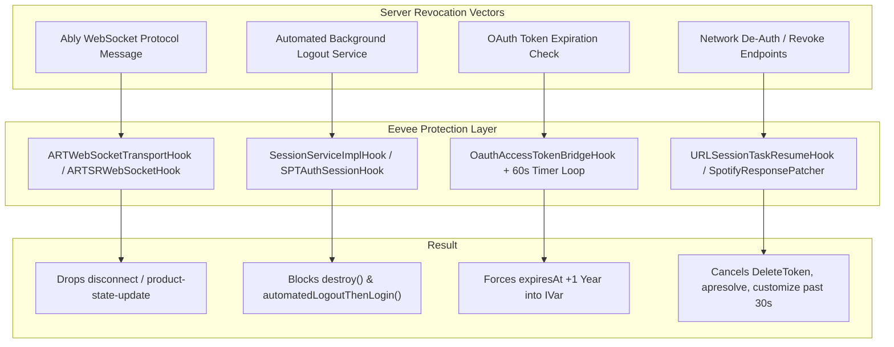

# Session Protection & Anti-Detection in EeveeSpotify

## 1. The Spotify Forced Logout Problem (v9.1.x)

In modern Spotify versions (notably v9.1.22 through v9.1.84+), the client implements aggressive integrity checks and push-based session revocations. When a user account connects with spoofed product attributes (e.g. `type = "premium"`) while Spotify's backend knows the account is Free, the backend initiates several revocation mechanisms:
1. **Push Revocation via Ably WebSockets**: Spotify pushes real-time `ap://product-state-update` or session termination messages.
2. **Automated Logout Services**: Swift background services (e.g., `SessionServiceImpl.automatedLogoutThenLogin`) trigger credential clearing and session tear-down.
3. **OAuth Token Expiration**: The internal `OauthAccessTokenBridge` enforces a short token expiry that triggers an authentication refresh against Spotify's login daemons.
4. **Token Invalidation Endpoints**: Background calls to `DeleteToken`, `session/purge`, and `token/revoke`.

Eevee resolves this with a multi-layered defense called **Session Logout Protection** in `Sources/EeveeSpotify/SessionProtection.x.swift`.



---

## 2. Core Auth Session Interception (`SPTAuthSessionHook`)

Eevee hooks `SPTAuthSessionImplementation` via `ClassHook<NSObject>` in the `SessionLogoutAuthHookGroup`:

```swift
class SPTAuthSessionHook: ClassHook<NSObject> {
    static var allowLogout = false

    func logout() {
        if SPTAuthSessionHook.allowLogout { orig.logout() }
        else { writeDebugLog("[AUTH] Blocked logout()") }
    }

    func logoutWithReason(_ reason: AnyObject) {
        if SPTAuthSessionHook.allowLogout { orig.logoutWithReason(reason) }
        else { writeDebugLog("[AUTH] Blocked logoutWithReason: \(reason)") }
    }

    func callSessionDidLogoutOnDelegateWithReason(_ reason: AnyObject) {
        if SPTAuthSessionHook.allowLogout { orig.callSessionDidLogoutOnDelegateWithReason(reason) }
    }

    func destroy() {
        if SPTAuthSessionHook.allowLogout { orig.destroy() }
        else { writeDebugLog("[AUTH] Blocked session destroy") }
    }
}
```

### The `allowLogout` Intent Gate

To prevent locking the user into an account permanently, Eevee introduces an intentional escape hatch:
1. When the user explicitly taps "Log Out" in the settings UI, `userInitiatedLogout` on `_TtC24Connectivity_SessionImpl18SessionServiceImpl` is invoked.
2. Eevee checks `Thread.isMainThread`. If true, it temporarily sets `SPTAuthSessionHook.allowLogout = true` for **5 seconds** and calls `orig.userInitiatedLogout()`.
3. If `userInitiatedLogout` is called from a background thread (triggered by Spotify's automated telemetry or daemon routines), it is strictly blocked.

---

## 3. Connectivity Session Services (`SessionServiceImplHook`)

Targeting `_TtC24Connectivity_SessionImpl18SessionServiceImpl`:

```swift
class SessionServiceImplHook: ClassHook<NSObject> {
    func automatedLogoutThenLogin() {
        writeDebugLog("[SESSION] Blocked automatedLogoutThenLogin")
    }

    func sessionDidLogout(_ session: AnyObject, withReason reason: AnyObject) {
        if SPTAuthSessionHook.allowLogout { orig.sessionDidLogout(session, withReason: reason) }
        else { writeDebugLog("[SESSION] Blocked sessionDidLogout: \(reason)") }
    }
}
```

Similarly, `LegacyLoginControllerHook` hooks `SPTAuthLegacyLoginControllerImplementation`, blocking `destroySession`, `forgetStoredCredentials`, and `invalidate`.

---

## 4. OAuth Access Token Extension (`OauthAccessTokenBridgeHook`)

Targeting `_TtC24Connectivity_SessionImplP33_831B98CC28223E431E21CD27ADD20AF222OauthAccessTokenBridge`:

```swift
class OauthAccessTokenBridgeHook: ClassHook<NSObject> {
    func expiresAt() -> Any {
        return Date(timeIntervalSinceNow: 365 * 24 * 60 * 60)
    }

    func setExpiresAt(_ date: Any) {
        orig.setExpiresAt(Date(timeIntervalSinceNow: 365 * 24 * 60 * 60))
    }

    func `init`() -> NSObject? {
        let result = orig.`init`()
        extendExpiryIvar()
        startExpiryExtender()
        return result
    }
}
```

### Direct IVar Injection & Periodic Thread
Spotify's underlying C++ core frequently bypasses Objective-C property setters and writes directly to the backing ivar `_expiresAt`. Eevee counters this at two levels:
1. **Direct IVar Overwrite**: Using `class_getInstanceVariable` and `object_setIvar`, forcing `_expiresAt` to 1 year in the future.
2. **Periodic Daemon Thread**: Starts a weak-referenced background dispatch queue executing every 60 seconds to re-assert the far-future date in `_expiresAt` if Spotify's C++ routines modified it.

---

## 5. Ably WebSocket Filtering (`ARTWebSocketTransportHook`)

Spotify uses Ably real-time transport to deliver push events and synchronization updates. Eevee hooks both `ARTWebSocketTransport` and `ARTSRWebSocket`:

### Blocked Action Codes
```swift
// 5=disconnect, 6=disconnected, 7=close, 8=closed, 9=error, 12=detach, 13=detached, 17=auth
private let blockedAblyActions: Set<Int> = [5, 6, 7, 8, 9, 12, 13, 17]
```

### Action 15 Payload Inspection (`product-state-update`)
When Ably delivers message action 15 (`message`), Eevee parses the JSON payload string:
- If the payload contains `product-state-update`, `product_state_update`, or `productStateUpdate`, Eevee **drops the message immediately**.
- **Why this is critical**: A server-pushed `product-state-update` triggers the client to fetch `/v1/customize` or `/bootstrap`, overriding the patched configuration and reinstating ads and playback restrictions.

---

## 6. Network Task Revocation Interception (`URLSessionTaskResumeHook`)

Eevee installs a global hook on `NSURLSessionTask.resume()` in `SessionLogoutNetworkHookGroup`.

### Startup Grace Period (30 Seconds)
During the initial 30 seconds of app launch, auth and login endpoints (`signup/public`, `apresolve`, initial `customize`) are allowed through to permit legitimate user login and initial bootstrap.

### Post-30s Revocation Blocklist
Once `elapsed > 30s`, `URLSessionTaskResumeHook` and `SpotifyResponsePatcher.shouldBlock` actively cancel or synthesize dummy responses for:
- `DeleteToken`: Outbound request to revoke the current token.
- `signup/public`: Background probe that can invalidate credentials.
- `pses/screenconfig`: Screen configuration checks.
- `/v1/customize`: Background re-fetches (e.g. `AuthFetcher`) that bypass `SPTDataLoaderService`.
- `apresolve`: Background access point re-resolution.
- `session/purge` and `token/revoke`: Synthetic `{"status":"OK"}` returned to satisfy callers while keeping the session active.

