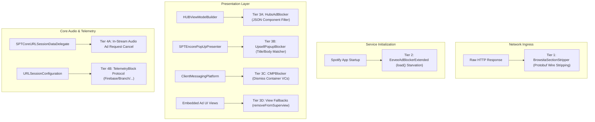

# Multi-Layer Ad & Upsell Blocking Architecture

EeveeSpotify implements a defense-in-depth ad blocking pipeline across four distinct tiers:
1. **Wire-Level Protobuf Stripping**: Surgical inspection of raw binary protocol buffers before deserialization.
2. **Swift Service Starvation**: Suppressing `load` on internal Spotify advertising subsystems.
3. **UI & View Model Filtering**: Intercepting Hub JSON view models, Encore modal presenters, and CMP containers.
4. **Network & Telemetry Suppression**: Blocking audio ad requests in player core and suppressing external tracking SDKs.



---

## 1. Tier 1: Wire-Level Protobuf Stripping (`BrowsitaSectionStripper`)

Located in `Sources/EeveeSpotify/Premium/Helpers/BrowsitaSectionStripper.swift`, this component processes HTTP responses for feed endpoints:
- `/casita/` (Home feed tabs and sections)
- `/browsita/` (Search and Browse layouts)
- `/scrollsita/` (Now Playing scroll feed and under-player cards)

### Why Wire-Level Stripping is Necessary
Modern Spotify versions render home and browse surfaces using declarative backend payloads (e.g., `NpvScrollResponse`, `CasitaResponse`). If ad sections exist in the protobuf, the application instantiates complex view hierarchies that may render before client-side hooks attach. `BrowsitaSectionStripper` operates directly on binary `Data` bytes without needing the compiled `.proto` schema.

### Protobuf Wire Parsing Algorithm
1. **Varint Reader**: Reads standard Protobuf variable-length integers (up to 10 bytes).
2. **Tag & Wire Type Decoding**: Dissects field numbers and wire types (0 = Varint, 1 = 64-bit, 2 = Length-delimited, 5 = 32-bit).
3. **Section Marker Scanning**: Scans length-delimited bytes for hard ad signatures.

### Hard Ad Markers
```swift
private static let hardAdMarkers: [[UInt8]] = [
    "spotify:ad:", "open.spotify.com/ad/", "ad-formats", "advertisement", "brand-ad",
    "sponsored", "marquee", "promoted", "home-ads", "adsproduct",
    "leavebehind", "leave-behind", "premium-upsell", "premium_upsell",
    "premiumupsell", "referralsupsellcard",
    "aet.spotify.com" // Spotify Ad Event Tracking host
]
```

### Surgical Repeated Field Dropping
- When an ad marker is found inside a **repeated** protobuf field (wire type 2), that specific entry is excised from the stream.
- The parent container length varint is recomputed and rewritten.
- If no ad markers are found, bytes are returned unmodified (zero performance overhead or risk of byte corruption).

---

## 2. Tier 2: Swift Service Starvation (`EeveeAdBlockerExtended`)

Located in `Sources/EeveeSpotify/EeveeAdBlockerExtended.x.swift`. Modern Spotify on iOS decomposes ad logic into standalone Swift packages adhering to the `SPTService` protocol.

Each service defines a `load()` method where it sets up event observers, registers view elements, and attaches to the player core. Eevee hooks `load()` on **15+ distinct ad services** and returns immediately **without invoking `orig.load()`**:

| Target Service Class | Subsystem Suppressed |
| :--- | :--- |
| `_TtC19AdsPlatform_AdsImpl14AdsServiceImpl` | Central Ads Platform core service |
| `_TtC29AdsNowPlaying_InStreamAdsImpl18InStreamAdsService` | In-stream audio and video ads coordinator |
| `_TtC29AdsNowPlaying_EmbeddedNPVImpl22EmbeddedNPVServiceImpl` | Embedded ads in Now Playing View (NPV) |
| `_TtC36AdsStandalone_LeavebehindAdsBaseImpl25LeavebehindAdsBaseService` | Standalone leave-behind ad service |
| `_TtC36AdsStandalone_LeavebehindAdsBaseImpl33LeavebehindAdsBaseInternalService` | Internal leave-behind ad service |
| `_TtC35AdsEmbedded_AdsSponsoredContextImpl30AdsSponsoredContextServiceImpl` | Sponsored context engine |
| `_TtC48AdsEmbedded_AdsSponsoredContextNPBAttachmentImpl43AdsSponsoredContextNPBAttachmentServiceImpl` | Sponsored attachments on Now Playing Bar |
| `_TtC42AdsEmbedded_AdsSponsoredPlaylistHeaderImpl37AdsSponsoredPlaylistHeaderServiceImpl` | Sponsored headers in playlist views |
| `_TtC20NativeAds_LoggerImpl26NativeAdsLoggerServiceImpl` | Ad telemetry and logging service |
| `_TtC35AdsEmbedded_EmbeddedCTAElementsImpl32EmbeddedAdAdapterElementProvider` | CTA ad adapter provider |
| `_TtC32AdsEmbedded_EmbeddedPlaylistImpl22PlaylistAdControllerV2` | Playlist ad controller v2 |
| `_TtC32AdsEmbedded_EmbeddedPlaylistImpl24PlaylistAdControllerImpl` | Playlist ad controller impl |
| `_TtC37AdsEmbedded_EmbeddedAdPresentationKit28LeavebehindAdElementProvider` | Leavebehind presentation element provider |
| `_TtC35AdsEmbedded_EmbeddedCTAElementsImpl30EmbeddedCTAElementsServiceImpl` | Embedded CTA elements service |
| `_TtC36AdsEmbedded_EmbeddedAdControllerImpl31EmbeddedAdControllerServiceImpl` | Embedded ad controller service |

---

## 3. Tier 3: UI, Hubs & PopUp Dismissal

### HubsAdBlocker (`HubsAdBlocker.x.swift`)
Spotify's HubFramework builds views from JSON dictionaries. `HubsAdBlocker` hooks `HUBViewModelBuilderImplementation.addJSONDictionary:`:
- Filters dictionary keys across `body`, `header`, `overlays`, and `sections`.
- Recursively inspects component dictionaries for namespaces (`mobile`, `mobile-ads`), names (`display-ad-card`, `display-ad-element`, `fullbleed-display-card`, `native-ad-home-shelf`), and metadata boolean flags (`is_ad: true`, `is_sponsored: true`).
- Removes ad component dictionaries prior to layout tree generation.

### UpsellPopupBlocker (`UpsellPopupBlocker.x.swift`)
Drops legacy Encore dialog popups by hooking `SPTEncorePopUpPresenter.presentPopUp:`:
- Captures titles and descriptions from `SPTEncorePopUpDialogModel` (`initWithTitle:description:image:primaryButtonTitle:secondaryButtonTitle:`).
- Matches against known upsell strings (`"premium"`, `"upgrade"`, `"unlimited skips"`, `"free account"`, `"ad-free"`, etc., including Russian UI variants).
- If matched (and title is not Eevee's own `"EeveeSpotify"` dialog), the presentation call is dropped.

### ClientMessagingPlatformBlocker (`ClientMessagingPlatformBlocker.x.swift`)
Handles full-screen takeovers, center modals, and bottom sheets driven by `com.spotify.pendragon.v1.ClientMessageService`:
- Hooks `viewWillAppear:` on:
  - `FullscreenContainerViewController`
  - `ModalContainerViewController`
  - `ClientMessagingPlatformBottomSheetPageViewController`
- Immediately sets `view.isHidden = true` and calls `target.dismiss(animated: false, completion: nil)`.

### View-Level Removal Fallbacks
If an ad view somehow materializes, Eevee installs hooks on `didMoveToSuperview`:
- `_TtC18AdsPlatform_ECMKit37AdsSponsoredPlaylistHeaderCentralView`
- `_TtC35AdsEmbedded_EmbeddedCTAElementsImpl26EmbeddedAdAdapterElementUI`
- `_TtC22AdsPlatform_ElementKit15HtmlAdElementUI`
- `_TtC19AdsPlatform_DSAImpl11DSAMainView`
- `_TtC13Upsells_UIKit29SelfLoadingUpsellBannerUIView`
- Action: `view.isHidden = true; view.removeFromSuperview()`.

---

## 4. Tier 4: Audio Ads & Telemetry Suppression

### In-Stream Audio Ad Cancellation (`CoreURLSessionAdsKill`)
Audio playback ads in Spotify bypass standard data loaders and route through `SPTCoreURLSessionDataDelegate`. Eevee intercepts:
```swift
private func isCoreAdRequest(_ url: URL) -> Bool {
    let host = (url.host ?? "").lowercased()
    guard host.contains("spotify") || host.contains("spclient") else { return false }
    let path = url.path.lowercased()
    return path.contains("/ads/") || path.hasSuffix("/ads") || path.contains("/ad-logic/")
}
```
When detected in `URLSession:dataTask:didReceiveResponse:completionHandler:`, Eevee invokes `handler(.cancel)`. The playback core treats the ad fetch as a network failure and immediately skips to the next track.

### Third-Party Telemetry Blocking (`TelemetryBlock.x.swift`)
Eevee registers a custom `URLProtocol` (`TelemetryBlockProtocol`) and injects it into `URLSessionConfiguration.defaultSessionConfiguration` and `ephemeralSessionConfiguration`:
- Intercepts requests destined for:
  - **Firebase**: `app-measurement.com`, `firebaselogging-pa.googleapis.com`
  - **Crashlytics**: `crashlytics.com`
  - **Facebook**: `facebook.com/activities`, `ep1.facebook.com`, `ep2.facebook.com`
  - **Branch Metrics**: `branch.io/v1/event`
  - **Comscore**: `scorecardresearch.com`
  - **Segment**: `segment.io`, `zqtk.net`
  - **Google Ads / DoubleClick**: `google-analytics.com`, `googleadservices.com`, `doubleclick.net`
- Automatically returns HTTP `204 No Content` to avoid crashing client analytics SDKs while preventing outbound data exfiltration.

