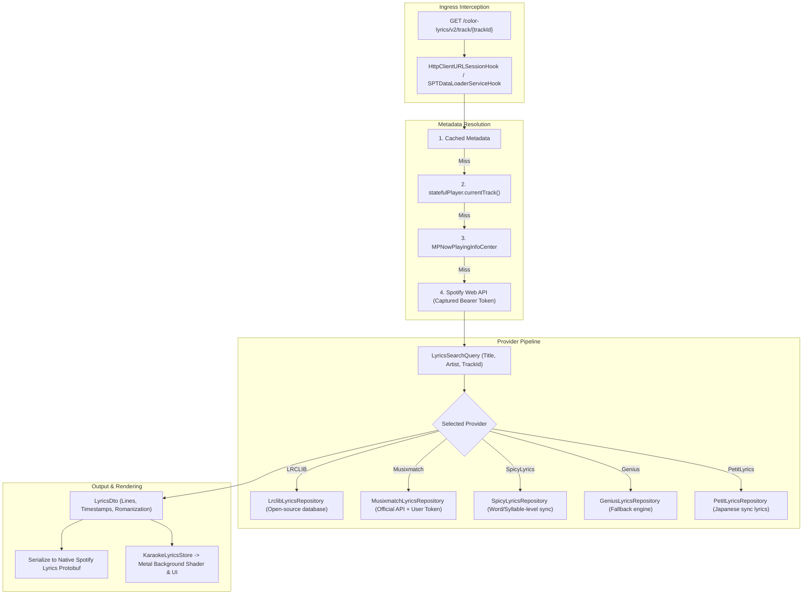
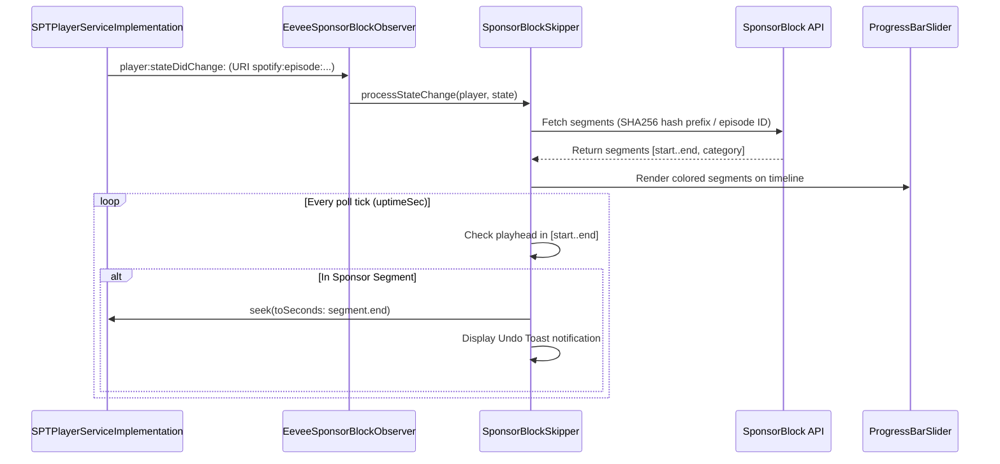

# Custom Lyrics Engine & SponsorBlock Integration

## 1. Custom Lyrics Engine Architecture

Spotify periodically restricts or paywalls synchronized lyrics for free users and relies on official Musixmatch licensing. Eevee provides a modular lyrics replacement subsystem capable of querying multiple third-party providers, serializing the lyrics into Spotify's native `Lyrics` Protobuf structure, and injecting an advanced Metal-rendered karaoke experience.

---

## 2. Lyrics Providers & Feature Matrix

| Provider | Sync Precision | Token Required | Romanization | Translation | Notes |
| :--- | :--- | :--- | :--- | :--- | :--- |
| **LRCLIB** | Line-synced | No (Free/Open) | Optional | No | Cleanest crowd-sourced source for popular music. |
| **Musixmatch** | Line-synced | Yes (App Token) | Supported | Supported | Direct official database; Eevee provides an in-app token extraction utility. |
| **SpicyLyrics** | Syllable-synced | Yes | Supported | Supported | Ultra-high fidelity word-by-word Apple Music-style highlighting. |
| **Genius** | Unsynced (Text) | No | Limited | No | Primary fallback when synced timestamps are unavailable. |
| **PetitLyrics** | Line & Word | No | Japanese native| No | Specialized for J-Pop, Anime, and Asian catalogs. |

---

## 3. Metadata Extraction & Prefetching

### 4-Tier Metadata Fallback
When Spotify requests lyrics via `/color-lyrics/v2/track/{trackId}`, the URL path provides only the 22-character alphanumeric Spotify track identifier. Because providers like LRCLIB and Genius require song title and primary artist name, Eevee resolves track metadata using four cascading fallbacks:
1. **Cached Metadata**: Checks if `capturedTrackId == trackId`.
2. **`statefulPlayer`**: Accesses Spotify's internal player instance `statefulPlayer.currentTrack()`, reading `trackTitle()` and `artistName()`.
3. **`MPNowPlayingInfoCenter`**: Dispatches to the main thread to read `MPMediaItemPropertyTitle` and `MPMediaItemPropertyArtist` from the system audio session.
4. **Spotify Web API**: Uses captured Bearer OAuth tokens to query `https://api.spotify.com/v1/tracks/{trackId}` directly.

### Predictive Prefetching (`prefetchLyricsIfNeeded`)
To prevent noticeable loading delays when opening the Now Playing View, Eevee triggers `prefetchLyricsIfNeeded(trackId:)` as soon as track playback begins. Prefetched results are stored in memory and instantly handed to the `/color-lyrics/v2` delegate handler when requested.

### Native Protobuf Re-Serialization
Spotify's UI renders lyrics from a binary `Lyrics` Protobuf structure. In `LyricsDto.toSpotifyLyricsData()`, Eevee maps third-party timestamps to native fields:
- `startTimeMs`: Converted to milliseconds.
- `words`: The lyric string.
- `syllables`: Word-level breakdown array (for SpicyLyrics).
- `colors`: Injected from `SPTNowPlayingBackgroundViewModel` or static settings.

---

## 4. Metal Karaoke & UI Customization

Beyond replacing Spotify's lyrics feed, Eevee provides a custom Karaoke presentation mode:
- **`KaraokeBackgroundShader.metal`**: A custom Metal fragment shader generating animated, fluid gradients that react dynamically to album artwork palette colors extracted via `AlbumArtColorExtractor.swift`.
- **`LiquidGlass`**: Glassmorphism visual blur effects for the Now Playing bar and tab bars using UIKit private layer blurs and `EncoreBridge.m`.
- **`KaraokeOverlayPresenter`**: Displays word-by-word fluid typography that tracks playback head position via `KaraokePlaybackTracker`.

---

## 5. SponsorBlock for Podcasts

Eevee integrates the open-source **SponsorBlock** database to skip sponsor messages, intros, and self-promotions in podcast episodes.

### Key Technical Details

1. **Player Observer Hook**: Hooks `SPTPlayerServiceImplementation.addPlayerObserver:` and registers an `EeveeSponsorBlockObserver` to receive playback state events.
2. **Episode URI Discrimination**: Inspects `track.URI` for `spotify:episode:` or `/episode/` schemes, ensuring music playback is never disrupted.
3. **Seek Accuracy & Timing**: Calculates monotonic timestamps (`uptimeSec()`) multiplied by `lastPlaybackSpeed` to maintain playhead estimation between Spotify's throttled state updates.
4. **Timeline Overlay**: Hooks `ProgressBarSliderHook` (`_TtCO17NowPlaying_ECMKit11ProgressBar6Slider`) to draw category-colored segment blocks directly onto the native scrubber bar.
5. **Interactive Undo Toast**: When an automatic skip occurs, `SponsorBlockToast` presents a non-intrusive banner allowing the user to tap "Undo", which seeks back to the start and marks the segment in `playthroughAllowed` so it is not re-skipped.
6. **In-App Submission & Voting**: Includes UI sheets to report new segments, vote on existing community submissions, and view local submissions.

