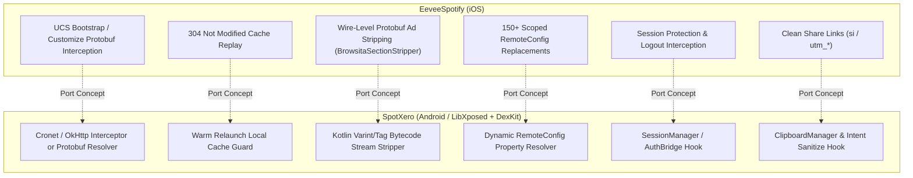

# Auxiliary Features & Cross-Platform Parity Insights for SpotXero

## 1. Auxiliary Features in EeveeSpotify

Beyond core premium unlocks, EeveeSpotify includes several quality-of-life enhancements and hardening fixes:

### 1.1 Clean Share Links (`CleanShareLinks.x.swift`)
Spotify embeds tracking and referral parameters in all shareable URLs (e.g., `https://open.spotify.com/track/...?si=abc123xyz&utm_source=...`). Eevee intercepts URLs across three system boundaries:
1. **`UIPasteboard`**: Cleans copied URLs in `setString:`, `setURL:`, `setItems:`, and `setData:forPasteboardType:`. Also swizzles concrete subclass implementations (`UIPasteboardAutomaticPasteboard`).
2. **`UIActivityViewController`**: Sanitizes URLs passed to the native iOS share sheet.
3. **`UIApplication.openURL`**: Intercepts deep-links generated for third-party apps (WhatsApp, Instagram Stories, Telegram) that bypass pasteboard or share sheets.

### 1.2 True Shuffle (`TrueShuffle.x.swift`)
Stops Spotify's "Smart Shuffle" from injecting algorithmic recommendations into playlist playback. Eevee targets `.SmartShuffleHandlerImplementation` and forces:
- `checkRecommendationsEnabled` -> `false`
- `recommendationIsBeingAddedWithTrackID:` -> `false`

### 1.3 CarPlay Crash Prevention (`CarPlayCrashFix.x.swift`)
On sideloaded or resigned IPAs without official CarPlay entitlements, CarPlay private callbacks can raise unhandled `NSException` errors that terminate the process. Eevee hooks `CPInterfaceController` (`clientAssistantCellUnavailableWithError:`) and `CPListTemplate` (`setAssistantCellConfiguration:`) and swallows the exceptions, trading a degraded CarPlay state for app stability.

### 1.4 Siri Radio Bypass (`SiriNoPlayAsRadio.x.swift`)
When a free user requests a song via Siri, Spotify encodes `restriction: "play-as-radio"` and `:station` inside a base64-encoded JSON payload within `INMediaItem.identifier`. Eevee decodes the payload, excises `:station` and the restriction flag, and re-encodes it so Siri plays the exact track requested on demand.

### 1.5 Full Environment Reset (`FullResetHelper.swift`)
Provides a comprehensive one-tap wipe of the Spotify environment:
- Iterates and deletes all Keychain items matching `"spotify"` across Generic Password, Internet Password, Key, and Certificate classes.
- Purges `UserDefaults.standard` and removes the persistent app domain.
- Recursively deletes cached sandboxed directories (`Library/`, `Documents/`, `Caches/`, `tmp/`).
- Wipes App Group shared containers (`group.com.spotify.client`, etc.).

---

## 2. Cross-Platform Parity Insights for SpotXero (Android)

While EeveeSpotify operates in an Objective-C / Swift Orion environment on iOS, the Spotify application architecture, network protocol, and backend endpoints are **fundamentally shared across Android and iOS**.

Below is a roadmap of architectural insights and actionable porting opportunities for SpotXero:

### 2.1 Wire-Level Protobuf Ad Stripping (`BrowsitaSectionStripper`)
- **The Android Challenge**: On Android, home and browse feeds are received via Protobuf over gRPC / Cronet. Decompiling Spotify to generate Java classes for every Protobuf schema is fragile and breaks across app updates.
- **The Eevee Solution**: Eevee's `BrowsitaSectionStripper` does not rely on generated classes or schema definitions. It parses the binary Protobuf wire format directly:
  1. Reads varints and tags.
  2. Scans for length-delimited byte sequences matching `"spotify:ad:"`, `"aet.spotify.com"`, `"ad-formats"`, `"leavebehind"`, or `"referralsupsellcard"`.
  3. Surgically excises repeated fields and updates the parent container length.
- **SpotXero Opportunity**: Porting this wire-level Protobuf stripper to Kotlin in SpotXero provides an update-resilient home feed ad blocker that operates on raw byte buffers before model deserialization.

### 2.2 Scoped RemoteConfig Property Replacements
- Eevee identifies critical scoped RemoteConfig property names in modern Spotify:
  - `ios-feature-settings.crossfade_enabled` -> Android equivalent `crossfade_enabled`
  - `core-playback-setup.crossfade_enabled`
  - `enable_common_capping` and `enable_pick_and_shuffle_common_capping`
  - `enable_mft_plus_queue` and `ios-feature-queue`
  - `ios-feature-adonappopen` and `ios-feature-marquee`
  - `ios-feature-leavebehindadsbase`
  - `ios-feature-instreamads`
- SpotXero can consolidate these property keys into its `RemoteConfigHook` and dynamic config resolvers to guarantee comprehensive coverage across capping and ad features.

### 2.3 304 Cache Replay & Warm Relaunch Defense
- On Android, Spotify uses Cronet and disk caching. On warm relaunch, if Spotify revalidates remote configuration and receives a 304, it might read unpatched configuration from disk.
- Persisting the patched configuration payload and synthesizing a 200 OK replay (or intercepting disk cache reads) prevents ad flags from re-enabling mid-session.

### 2.4 Session Protection & Token Extension
- Android users frequently report unexpected logouts when Spotify detects entitlement changes.
- SpotXero can identify and hook Spotify's Android `SessionManager` / `AuthSession` components:
  - Block automated logout calls that lack user UI intent.
  - Extend OAuth token expiry timestamps.
  - Suppress server-pushed product-state revocation messages over WebSockets/gRPC.

### 2.5 Clean Share Links
- Intercepting `android.content.ClipboardManager.setPrimaryClip` and `Intent.ACTION_SEND` within Spotify on Android to strip `?si=...` and `&utm_*` tracking queries gives Android users the same privacy enhancement.

