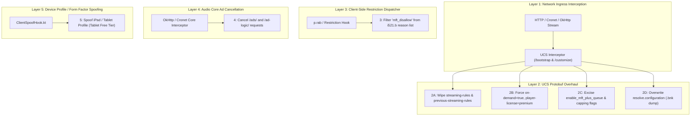

# Defeating `mft_disallow` & Playback Stalls: Cross-Platform Strategy & Android Implementation Blueprint

**Document Reference**: `docs/mft-disallow-defeat-strategy.md`  
**Related Documents**:
- [`docs/playback-stall-mft-disallow-investigation.md`](file:///home/s1ddhants1/Projects/spotify/spotxero/docs/playback-stall-mft-disallow-investigation.md)
- [`docs/eevee-spotify-analysis/01-bootstrap-and-ucs-mutation.md`](file:///home/s1ddhants1/Projects/spotify/spotxero/docs/eevee-spotify-analysis/01-bootstrap-and-ucs-mutation.md)
- [`docs/eevee-spotify-analysis/02-session-protection-and-anti-detection.md`](file:///home/s1ddhants1/Projects/spotify/spotxero/docs/eevee-spotify-analysis/02-session-protection-and-anti-detection.md)

---

## 1. Executive Summary & Root Cause Architecture

### 1.1 The Problem: The ~9.6-Second Cutoff
In Spotify Free tier, tapping an on-demand track outside of a pre-authorized shuffle/radio sequence triggers a hard playback failure:
1. **0.0s – ~9.6s**: The introductory audio chunk (~160–320 KB) is loaded into the initial playback buffer and plays normally.
2. **~9.6s**: The playback engine reaches the low-water mark and issues an HTTP Range request to the audio CDN for chunk 2.
3. **The Stall**: The stream broker evaluates the client entitlement. If the account is Free and running on a smartphone, it returns an **`mft_disallow`** ("Mobile Free Tier Disallow") restriction tag. The client player halts audio decoding, freezes at `position=9666ms`, and enters permanent `BUFFERING(6)` or `ERROR(7)` (`p.i521`).

```
0s                  ~8.0s - 9.6s                               Track End
├─────────────────────────┼────────────────────────────────────────┤
│ Initial Buffer Preview  │ Second Stream Chunk (CDN Range Request)│
│ (Delivered to Free Tier)│ [mft_disallow evaluated by Stream Broker]
└─────────────────────────┴────────────────────────────────────────┘
                          ▲
                          │ Stream broker / p.rab flags mft_disallow
                          ▼
                 Audio Sink Starves
                 Position = 9,666ms
                 State = BUFFERING(6)
```

### 1.2 Why High-Level Java Hooks Alone Fail
Historically, Xposed modules hook high-level Java wrappers (e.g., `ProductStateHook.kt` modifying `ProductState` maps, or `PlayerRestrictionsHook.kt` returning `Restrictions.EMPTY`). 

These hooks fail to stop the 9.6-second stall because:
- **The Native C++ Core (`liborbit.so`) Bypasses Java**: Spotify's audio streaming pipeline (`SPTCore`, `liborbit.so`) processes network streams and evaluates protobuf responses directly from the Unified Configuration Service (UCS).
- **Client-Side Restriction Parsing (`p.rab`)**: Spotify's internal event-driven player pipeline receives restriction codes directly from playback events and maps `"mft_disallow"` to `PREMIUM_ACCOUNT_REQUIRED` (`sgh0`), instructing the native sink to halt buffering.

---

## 2. Empirical Evidence Across Platforms (iOS vs. Android)

### 2.1 MFT is Universal, Not Android-Specific
Under Spotify’s licensing agreements with major record labels (Universal, Sony, Warner):
- **Desktop & Tablets (iPads / Android Tablets)**: Users are legally permitted to select and play individual tracks on-demand on the Free tier (monetized via audio/display ads).
- **Smartphones (iPhones / Android Phones)**: Strictly designated as **MFT**. Users are barred from on-demand track selection and forced into shuffle/radio mode with hourly skip limits.

Analysis of the decrypted iOS 9.1.94 binary (`com.spotify.client-9.1.94.ipa`) confirms identical MFT enforcement symbols:
- `MftCanPlayChecker` (`initWithMftCanPlayChecker:scheduler:`)
- `_TtC14Queue_ViewImpl29MftPlusQueuePublisherProvider`
- `_TtC21Curation_PlatformImpl30CUPMFTInjectionCurationHandler`
- `_TtC23NowPlaying_ElementsImpl37ShuffleMftPlusQueueElementFactoryImpl`
- RemoteConfig flags: `enable_mft_plus_queue`, `enable_mft_plus_extended_queue`, `enable_mft_fallback_loader`

> [!IMPORTANT]
> Spoofing an **iPhone** identity alone does **NOT** defeat `mft_disallow`, because iPhones are subject to the same smartphone licensing restrictions. To defeat it, we must either rewrite the UCS payload at the network boundary (Eevee's method) or spoof a **Tablet (iPad)** client profile.

---

## 3. The Comprehensive Multi-Layer Defeat Strategy

To guarantee sustained on-demand playback without stalls or server rejections, SpotXero will implement a **5-layer containment architecture** derived from EeveeSpotify's battle-tested iOS implementation:



---

## 4. Layer-by-Layer Technical Blueprint

### Layer 1: Ingress UCS Protobuf Mutation
Instead of waiting for Java objects to be constructed, intercept the **raw protobuf byte stream** as it enters the process from the network.

* **Target Endpoints**:
  * `/bootstrap/v1/bootstrap` (delivers initial `BootstrapMessage`)
  * `/remote-config-orchestrator/v1/customize` (delivers `CustomizeMessage`)
* **Mechanism**:
  1. Buffer incoming stream chunks in an OkHttp/Cronet interceptor.
  2. Parse the bytes into `UcsResponse`.
  3. Apply mutations (Layers 2A–2D).
  4. Re-serialize modified bytes downstream.
* **Warm Relaunch (304 Not Modified) Protection**:
  * When Spotify sends `If-None-Match`, the server returns `304 Not Modified`.
  * If the process restarted, the in-memory cache is cold.
  * Persist the patched customize payload to disk. When a `304` is received, synthesize a `200 OK` and replay the cached bytes so Spotify never falls back to an unpatched disk cache.

---

### Layer 2: Account Attribute & RemoteConfig Cleansing

#### 2A: Wiping `streaming-rules`
Spotify’s backend encodes restriction rules into the `streaming-rules` account attribute (e.g., `shuffle-only`, capping thresholds). Clearing this attribute informs both native C++ and Java players that no streaming rules constrain the account:
```kotlin
attributes["streaming-rules"] = ""
attributes["previous-streaming-rules"] = ""
```

#### 2B: Setting the Identity Tuple
Force the core licensing and capability attributes:
```kotlin
attributes["on-demand"] = true
attributes["shuffle-eligible"] = true
attributes["unrestricted"] = true
attributes["type"] = "premium"
attributes["catalogue"] = "premium"
attributes["player-license"] = "premium"
attributes["player-license-v2"] = "premium"
attributes["financial-product"] = "pr:premium,tc:0"
attributes["can_use_superbird"] = true
attributes["nft-disabled"] = "1"
attributes["high-bitrate"] = true
```

#### 2C: Stripping Trial & Verification Keys
Remove attributes that trigger client-side verification daemons:
```kotlin
val keysToStrip = setOf(
    "payment-state",
    "last-premium-activation-date",
    "on-demand-trial",
    "on-demand-trial-in-progress",
    "smart-shuffle",
    "at-signal",
    "feature-set-id-masked",
    "strider-key",
    "is-eligible-for-trial",
    "is-eligible-for-upsell"
)
keysToStrip.forEach { attributes.remove(it) }
```

#### 2D: Excising MFT & Capping Flags from RemoteConfig
In `assignedValues`, strip the flags that construct MFT queues and timeout monitors:
```kotlin
val mftFlagsToRemove = setOf(
    "enable_mft_plus_queue",
    "enable_mft_plus_extended_queue",
    "is_remove_from_queue_enabled_for_mft_plus",
    "is_reordering_for_mft_plus_allowed",
    "enable_common_capping",
    "enable_pns_common_capping",
    "enable_pick_and_shuffle_common_capping",
    "enable_pick_and_shuffle_dynamic_cap",
    "pick_and_shuffle_timecap",
    "enable_free_on_demand_experiment",
    "enable_free_on_demand_context_menu_experiment"
)

// Force playback timeout monitors off:
assignedValues["enable_playback_timeout_service"] = false
assignedValues["enable_playback_timeout_error_ui"] = false
assignedValues["playback_timeout_action"] = "Nothing"
```

#### 2E: The Nuclear Option — Overwriting `resolve.configuration`
If server cohorts force client-side playback restrictions via complex flag combinations:
* Bundle a serialized binary dump of `ResolveConfiguration` from an active Premium account (as Eevee does with [`resolveconfiguration_9_1_76.bnk`](file:///home/s1ddhants1/Projects/spotify/eevee-spotify-reincarnated/layout/Library/Application%20Support/EeveeSpotify.bundle/resolveconfiguration_9_1_76.bnk)).
* Place this payload in SpotXero's `app/src/main/assets/resolveconfiguration.bnk`.
* Overwrite `ucsResponse.resolve.configuration` with the asset bytes upon receiving `/bootstrap/v1/bootstrap`.

---

### Layer 3: Client-Side Restriction Dispatcher Hook (`p.rab`)

In `classes4.dex` of Spotify Android 9.1.94, class `p.rab` maps incoming playback restriction models:

```java
// p/rab.java
i521 i521Var = (i521) obj;
if (i521Var.b.contains("mft_disallow")) {
    dev0Var = new dev0(i521Var.a); // PREMIUM_ACCOUNT_REQUIRED (g2z.d)
}
```

* **Hook Signature**:
  Using DexKit, locate the method in `p.rab` containing the string constant `"mft_disallow"`.
* **Action**:
  Intercept `i521Var.b` (the `List<String>` of restriction reasons):
  ```kotlin
  if (reasonsList.contains("mft_disallow")) {
      val mutableReasons = ArrayList(reasonsList)
      mutableReasons.remove("mft_disallow")
      // Update field on i521 instance
  }
  ```
* **Result**:
  If `"mft_disallow"` is absent from the list, `p.rab` never converts the state to `PREMIUM_ACCOUNT_REQUIRED`, preventing `sgh0` from halting buffer progress.

---

### Layer 4: Audio Ad Break URL Cancellation

In-stream audio ads are fetched directly by Spotify’s native playback core via:
* `/ads/`
* `/ad-logic/prefetch`
* `/ad-logic/v3/config`

In `EeveeAdBlockerExtended.x.swift`, Eevee cancels these requests at the response boundary (`handler(.cancel)`).
On Android:
* Intercept `OkHttpClient` / Cronet requests destined for these paths.
* Cancel or return an immediate network failure (e.g. HTTP 500 / abort).
* **Behavior**: Spotify's C++ audio player core treats the ad load as a failed network request and skips directly to the next scheduled song without freezing playback.

---

### Layer 5: Device Profile / Form Factor Spoofing (Tablet Free Tier)

If backend token brokerage continues to restrict mobile phone clients, we can exploit the legal label exemption: **Tablets have full on-demand pick-and-play privileges on the Free tier**.

Instead of spoofing an iPhone (`iPhone17,1`), spoof an **iPad** or **Android Tablet**:

| Attribute | Phone Value | Tablet Value (Exempt from MFT) |
| :--- | :--- | :--- |
| **Hardware Model** | `iPhone17,1` / `CPH2573` | `iPad16,3` (iPad Pro 11" M4) or `iPad14,8` |
| **User Agent** | `Spotify/9.1.94.1928 iOS/18.2 (iPhone17,1)` | `Spotify/9.1.94.1928 iOS/18.2 (iPad16,3)` |
| **Product State** | `tablet-free: false` | `tablet-free: true` |

By presenting the client as a tablet during the login and application scope handshakes (`ClientSpoofHook.kt`), Spotify's backend stream broker generates stream authorization tokens that permit on-demand track streaming natively.

---

## 5. Verification Checklist & Safety Precautions

When testing the implementation on physical hardware (e.g., OnePlus 12R):

1. **Verify No 9.6s Stall**:
   Execute `dumpsys media_session` after 15 seconds of sustained playback:
   ```bash
   adb shell dumpsys media_session | grep -E "state=PlaybackState|position="
   ```
   *Success Condition*: `state=PLAYING(3)` with `position > 15000` (beyond the 9666ms cutoff).
2. **Verify Track Transitions**:
   Skip 5 tracks consecutively on an on-demand playlist to confirm the 0-second skip loop does not trigger.
3. **Never Spoof `country`**:
   Ensure `country` is never overwritten in `accountAttributes` to prevent CDN 403 geo-mismatch errors.
4. **Never Spoof Offline / Very High Bitrate**:
   Keep `very-high-bitrate`, `offline`, and remote `jam-social-session` untouched in `ServerSidedFeaturePolicy`.

