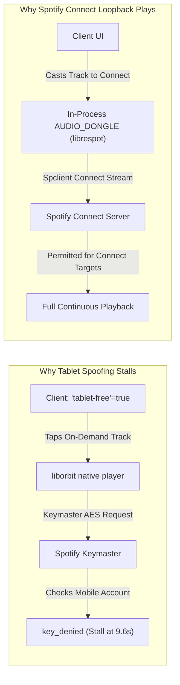

# Tablet Tier Analysis & `mft_disallow` Keymaster Mechanics

## 1. Executive Summary

A frequent inquiry in Spotify reverse engineering is:
> *"Spotify on Android tablets allows Free-tier users to pick and play any track on demand with ads. Why can't we simply spoof the client to the tablet product tier (`tablet-free`) to unlock on-demand playback on mobile?"*

### The Short Answer
1. **At the UI layer, spoofing `tablet-free` works**: SpotXero already spoofs `"tablet-free" to true` in [`ProductStateHook.kt`](file:///home/s1ddhants1/Projects/spotify/spotxero/app/src/main/kotlin/app/spotxero/hooks/ProductStateHook.kt). This successfully unlocks tablet UI capabilities: playlist headers display the normal green "Play" button, individual tracks can be tapped directly, and the shuffle restriction badge disappears.
2. **At the native audio streaming layer, playback still stalls at ~9.6 seconds**: Even when the UI operates in tablet mode, audio playback freezes after ~9,666 milliseconds.
3. **The Root Cause**: Audio delivery in Spotify is **two-staged**. The first ~9.6 seconds play from an unencrypted CDN burst for instant Time-To-First-Audio (TTFA). Continuation past 9.6 seconds requires an **AES-128 audio frame decryption key** from Spotify's remote **Keymaster** service. Keymaster checks the user's server-side account entitlement and session device class, NOT the client's local memory. When on-demand streaming is requested on a mobile free account, Keymaster refuses the key (`RESTRICTED` / `key_denied`).
4. **How ReVanced Solved This**: Instead of trying to spoof a tablet device to Keymaster, ReVanced PR #5482 recognized that **Spotify Connect targets (e.g. `AUDIO_DONGLE` / `SPEAKER`)** are exempt from `mft_disallow`. ReVanced implemented an in-process Connect receiver ([`AndroidZeroconfServer.java`](file:///home/s1ddhants1/Projects/spotify/revanced-patches/extensions/spotify/src/main/java/app/revanced/extension/spotify/misc/fix/AndroidZeroconfServer.java)) that plays audio outside the native `liborbit` player.

---

## 2. Spotify's Streaming Rule Matrix

Inside Spotify's Android codebase (`classes7.dex`, decompiled from v9.1.94.1929), streaming behavior is categorized by the `p.ium1` enum representing internal product rules:

| Enum Constant | Raw Value | Rule Name | Business Behavior |
|---|---|---|---|
| `STREAMING_RULE_PREMIUM` | `1` | Premium | Full on-demand, unlimited skips, ad-free, high-bitrate audio. |
| `STREAMING_RULE_MOBILE_FREE` | `2` | Mobile Free Tier | **`mft_disallow` enforced**: Forced shuffle-only, 6 skips/hour, restricted on-demand. |
| `STREAMING_RULE_DESKTOP_FREE` | `4` | Desktop Free | On-demand playback allowed, linear playback with ads. |
| `STREAMING_RULE_TABLET_FREE` | `5` | Tablet Free | **On-demand playback allowed with ads**, linear playlist playback, pick-and-play enabled. |

### Decompiled Enum Resolution (`p.ium1.java`)

```java
package p;

public final class ium1 {
    public static final ium1 a = new ium1("STREAMING_RULE_UNKNOWN", 0);
    public static final ium1 b = new ium1("STREAMING_RULE_PREMIUM", 1);
    public static final ium1 c = new ium1("STREAMING_RULE_MOBILE_FREE", 2);
    public static final ium1 d = new ium1("STREAMING_RULE_MOBILE_FREE_CAN_PLAY_EXP", 3);
    public static final ium1 e = new ium1("STREAMING_RULE_DESKTOP_FREE", 4);
    public static final ium1 f = new ium1("STREAMING_RULE_TABLET_FREE", 5);
    // ...
}
```

The mapping between product-state strings and this enum is parsed when the client evaluates remote configuration attributes:
- When `"streaming-rules"` contains `"tablet-free"` or `"tablet"`, the client sets rule `f` (`STREAMING_RULE_TABLET_FREE`).
- When `f` is active, client-side gatekeepers permit linear playlist navigation and direct track taps.

---

## 3. The UI vs Keymaster Entitlement Asymmetry

```mermaid
flowchart TD
    subgraph UI & Navigation Layer (Java / Kotlin)
        Hook["ProductStateHook / AccountAttribute"] -->|Injects 'tablet-free'=true| ProtoMap["ProductStateProto Map"]
        ProtoMap --> FeatureCheck["Feature: on-demand & linear play"]
        FeatureCheck --> UIRender["UI: Un-shuffles Playlists, Enables Track Tap"]
    end

    subgraph Native Audio Engine (liborbit-jni-spotify.so)
        UIRender -->|User Taps Track| OrbitQueue["core-list-player (MftQueue)"]
        OrbitQueue --> PreRoll["Stage 1: CDN Pre-roll Burst (160 KB - 320 KB)"]
        PreRoll --> AudioTrack["AudioFlinger Buffer: Plays 0.0s -> 9.6s"]
        
        OrbitQueue --> KeymasterReq["Stage 2: Keymaster Key Request (AES-128)"]
    end

    subgraph Spotify Server Cloud
        KeymasterReq -->|Remote RPC: storage-resolve.proto| Keymaster["Spotify Keymaster Service"]
        Keymaster --> AccountDB{"Check Remote Account Plan & Attestation"}
        AccountDB -->|Free Mobile Account| Deny["RESTRICTED / key_denied"]
        AccountDB -->|Genuine Tablet / Premium| Grant["AES-128 Chunk Key"]
    end

    Deny --> Starve["Native Engine: readDataInto: eos2"]
    Starve --> BufferHalt["Audio Buffer Drains -> BUFFERING(6) at 9666ms"]
    BufferHalt --> ErrorProp["Throw ERROR(7): p.i521"]
```

### 3.1 What SpotXero Already Spoofs
SpotXero's [`ProductStateHook.kt`](file:///home/s1ddhants1/Projects/spotify/spotxero/app/src/main/kotlin/app/spotxero/hooks/ProductStateHook.kt) already includes comprehensive product-state attribute spoofing:

```kotlin
val TYPED_SPOOFS = mapOf(
    "type" to "premium",
    "ads" to false,
    "on-demand" to true,
    "shuffle" to false,
    "streaming" to true,
    "pick-and-shuffle" to false,
    "streaming-rules" to "",
    "tablet-free" to true,      // <-- Tablet tier spoof is already active
    "player-license" to "premium",
    "player-license-v2" to "premium"
)
```

At the Java layer, this spoof is 100% effective:
- The app displays albums and playlists without forced shuffle.
- Any track in a playlist can be tapped and begins playing instantly.
- The playback notification and lock screen show the tapped track title.

---

## 4. The Two-Stage Audio Playback Architecture

Despite the UI operating in tablet mode, playback consistently freezes at ~9.65 seconds. The mechanism behind this cutoff was established by empirical tracing and disassembly of `liborbit-jni-spotify.so`:

### 4.1 Stage 1: The Fast-TTFA CDN Pre-roll
To guarantee near-instant playback when a user presses play (minimizing Time-To-First-Audio), Spotify serves an initial unencrypted or pre-authenticated audio burst (~160 KB to 320 KB) directly from its Akamai CDN:

```text
audio-ak-spotify-com.akamaized.net/...
```

- This chunk contains the Ogg/Vorbis audio headers and approximately **9 to 10 seconds of decoded PCM audio**.
- `AudioTrack` and `AudioFlinger` accept this burst and begin playing immediately.

### 4.2 Stage 2: The Keymaster Cryptographic Handshake
While the first 9 seconds are playing from the ring buffer, `liborbit-jni` initiates a background key exchange with Spotify's Keymaster service to decrypt subsequent audio segments:
- Routine: `_key_requester:`
- Protobuf schema: `storage-resolve.proto`
- Purpose: Retrieve the AES-128 content decryption key for the audio file ID.

When Keymaster processes this request:
1. It validates the user's **server-side account profile** in Spotify's backend database.
2. It verifies the **hardware attestation** and client type reported during session establishment.
3. Because the remote account is registered as a **Mobile Free Tier** user, the server determines that on-demand track streaming is disallowed (`mft_disallow` = `"CANT_PLAY_ON_DEMAND"` per `p.li51.java`).
4. Keymaster returns status code `RESTRICTED` or `key_denied`.

### 4.3 Pipeline Starvation at 9,666ms
Once the key request is denied:
1. The native reader logs:  
   `readDataInto: eos2, _is_processing_audio now false`
2. No further audio chunks can be decrypted or fed into the `AudioTrack` pipeline.
3. The remaining audio buffered in `AudioFlinger` drains until exactly **9,666ms** (or ~9.65s).
4. `MediaSession` transitions to `PlaybackState { state=BUFFERING(6), position=9666 }`.
5. The player enters an error state and throws `ERROR(7)` (`p.i521`).

---

## 5. The Solution: Spotify Connect Loopback vs Tablet Spoofing

ReVanced developers encountered this exact wall. Recognizing that client-side tablet spoofing cannot fool Keymaster, they designed the Spotify Connect loopback in [`SpoofClientPatch.java`](file:///home/s1ddhants1/Projects/spotify/revanced-patches/extensions/spotify/src/main/java/app/revanced/extension/spotify/misc/fix/SpoofClientPatch.java):



### Key Differences
1. **Device Type Target**: Spotify's backend treats Spotify Connect devices (`Connect.DeviceType.AUDIO_DONGLE` or `SPEAKER`) differently from mobile phones. Connect speakers are allowed full on-demand pick-and-play even on Free tier accounts.
2. **Independent Decryption**: The embedded [`librespot`](file:///home/s1ddhants1/Projects/spotify/revanced-patches/extensions/spotify/build.gradle.kts#L33) client handles its own key exchange through Spotify's Connect/Spclient infrastructure rather than through the mobile-restricted `liborbit-jni` pipeline.
3. **Hardware Playback**: Audio chunks are decoded via [`AndroidNativeDecoder.java`](file:///home/s1ddhants1/Projects/spotify/revanced-patches/extensions/spotify/src/main/java/app/revanced/extension/spotify/misc/fix/AndroidNativeDecoder.java) using Android's hardware `MediaCodec` and played via [`AndroidSinkOutput.java`](file:///home/s1ddhants1/Projects/spotify/revanced-patches/extensions/spotify/src/main/java/app/revanced/extension/spotify/misc/fix/AndroidSinkOutput.java).

---

## 6. Porting Comparison Matrix

| Attribute | Client-Side Tablet Spoofing (`tablet-free`) | Spotify Connect Loopback (`librespot`) |
|---|---|---|
| **UI State** | On-demand UI unlocked | On-demand UI unlocked |
| **Source Implementation** | [`ProductStateHook.kt`](file:///home/s1ddhants1/Projects/spotify/spotxero/app/src/main/kotlin/app/spotxero/hooks/ProductStateHook.kt) | [`SpoofClientPatch.java`](file:///home/s1ddhants1/Projects/spotify/revanced-patches/extensions/spotify/src/main/java/app/revanced/extension/spotify/misc/fix/SpoofClientPatch.java) |
| **Discovery Mechanism** | Local Proto injection | Local NSD via [`AndroidZeroconfServer.java`](file:///home/s1ddhants1/Projects/spotify/revanced-patches/extensions/spotify/src/main/java/app/revanced/extension/spotify/misc/fix/AndroidZeroconfServer.java) |
| **Audio Pre-roll** | Plays first ~9.65s | Plays continuously without time limits |
| **Keymaster Result** | Denied (`RESTRICTED`) | Bypassed via Connect protocol |
| **SpotXero Readiness** | Implemented & verified | Porting specification in [04-spotxero-porting-blueprint.md](04-spotxero-porting-blueprint.md) |
